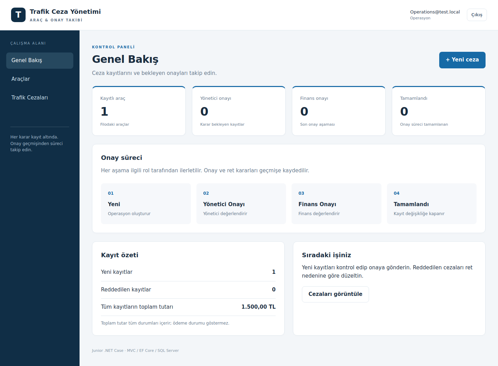
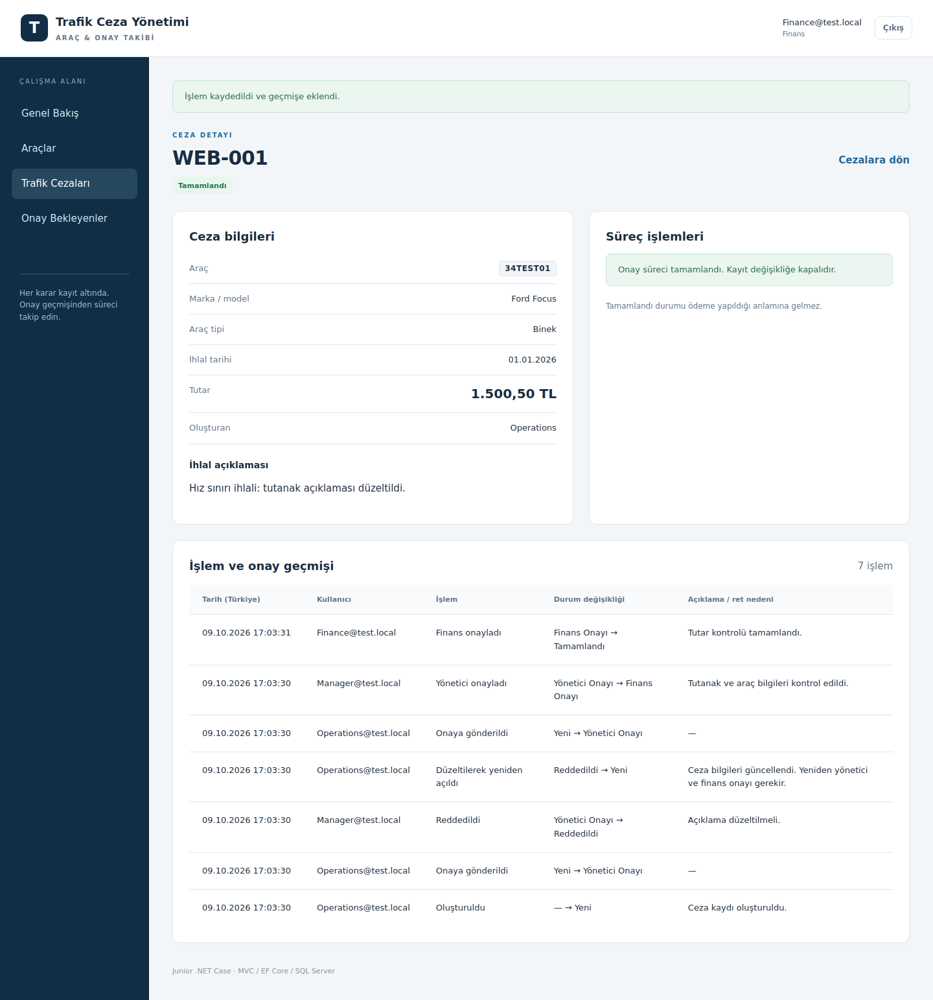

# Trafik Cezası Yönetim ve Onay Modülü

.NET 9 ASP.NET Core MVC, Entity Framework Core ve SQL Server ile araç kayıtlarını ve trafik cezalarının rol bazlı onay sürecini yöneten junior case uygulaması.

## Özellikler

- Araç ekleme, listeleme ve arama; Binek, Çekici, Dorse ve Kiralık Araç tipleri.
- Benzersiz plaka; boşluklardan arındırılmış, büyük harfli saklama.
- Ceza oluşturma, detay görüntüleme, arama, durum filtresi ve 15 kayıtlık sayfalama.
- ASP.NET Core Identity ile oturum açma ve rol kontrolü.
- Yeni → Yönetici Onayı → Finans Onayı → Tamamlandı.
- Yönetici ve finans aşamalarında gerekçeli ret.
- Reddedilen kaydı oluşturan operasyon kullanıcısının düzeltip Yeni durumuna döndürmesi; yeniden tüm onayların alınması.
- Kullanıcı, zaman, işlem, açıklama, önceki ve yeni durum bilgileriyle işlem geçmişi.
- Tamamlanmış ve onayda bekleyen kayıtların değiştirilememesi.
- Eşzamanlı işlemler için optimistic concurrency; karar ve geçmiş tek SaveChanges transaction'ında.
- Sunucu validation, antiforgery, kullanıcıya hata mesajları, loglama, responsive Türkçe arayüz.

## Ekran görüntüleri

MVC test host'unun ürettiği HTML ile alınan arayüz önizlemeleri (test verileri):





## Gereksinimler

1. **.NET 9 SDK** (runtime tek başına yeterli değildir). `dotnet --list-sdks` ile kontrol edin.
2. **SQL Server**. Windows için SQL Server Express LocalDB en kolay başlangıçtır; Visual Studio Installer'ın SQL Server Express LocalDB bileşeniyle veya SQL Server Express kurulumuyla edinilebilir. SQL Server Developer/Express sunucusu da kullanılabilir.
3. .NET paketlerini ilk kez indirmek için internet.
4. İsteğe bağlı VS Code veya .NET 9 destekli Visual Studio 2022 17.12+.

.NET 9 case'in açık beklentisi olduğu için hedef framework değiştirilmemiştir.

## Hızlı başlangıç (Windows / LocalDB)

Aşağıdaki komutları **TrafficFineCase.sln dosyasının bulunduğu klasörde** PowerShell'de çalıştırın.

```powershell
dotnet --list-sdks
sqllocaldb info MSSQLLocalDB
sqllocaldb start MSSQLLocalDB
dotnet restore
dotnet tool restore
dotnet dev-certs https --trust
dotnet user-secrets set "Demo:Seed" "true" --project src/TrafficFine.Web
dotnet user-secrets set "Demo:Password" "LocalDemo!2026" --project src/TrafficFine.Web
dotnet ef database update --project src/TrafficFine.Web
dotnet run --project src/TrafficFine.Web
```

`LocalDemo!2026` yalnızca yerel demo için örnek şifredir; farklı bir demo şifresi belirleyebilirsiniz. Örnek hesaplar ilk çalıştırmada bu değerle oluşturulur. Şifre veya SQL kimlik bilgilerini appsettings.json'a yazıp Git'e eklemeyin.

**Adres:** https://localhost:7104 (alternatif: http://localhost:5104, HTTPS'ye yönlendirilir).

| Demo e-posta | Rol | Yetki |
| --- | --- | --- |
| operasyon@case.local | Operations | Araç/ceza oluşturur; kendi Yeni kaydını düzenler/gönderir; kendi reddedilen kaydını düzeltir. |
| yonetici@case.local | Manager | Yönetici Onayı aşamasında onay veya gerekçeli ret verir. |
| finans@case.local | Finance | Finans Onayı aşamasında onay veya gerekçeli ret verir. |

Tüm hesapların başlangıç şifresi `Demo:Password` değeridir. Seeder yalnızca **Development** ortamında ve `Demo:Seed=true` ise çalışır. Tekrar çalıştırıldığında mevcut demo kullanıcılarının şifresini değiştirmez; tanımlı demo tutanaklarını çoğaltmaz. Beş durumun her biri için örnek kayıt oluşturur. Demo:Seed daha sonra false yapılabilir; kullanıcılar veritabanında kalır.

İsteğe bağlı yardımcı: `powershell -ExecutionPolicy Bypass -File scripts/setup-local.ps1`. Script restore, migration, demo şifresi ve HTTPS sertifikasını hazırlar; uygulamayı ayrıca yukarıdaki run komutuyla başlatın. Bypass yalnızca bu süreç için kullanılır.

## Başka bir SQL Server kullanmak

Bağlantı dizesini user-secrets ile değiştirin, sonra aynı migration/run komutlarını çalıştırın:

```powershell
dotnet user-secrets set "ConnectionStrings:DefaultConnection" "Server=localhost;Database=TrafficFineCase;Integrated Security=True;TrustServerCertificate=True" --project src/TrafficFine.Web
```

SQL authentication gerekiyorsa bağlantı dizesinde kendi `User Id` ve `Password` değerlerinizi kullanın. Linux/macOS'ta LocalDB bulunmaz; erişilebilir SQL Server sunucusu gerekir. Uygulama SQLite'a otomatik geçiş yapmaz.

Alternatif olarak `ConnectionStrings__DefaultConnection`, `Demo__Seed` ve `Demo__Password` ortam değişkenleri kullanılabilir. Demo seed yalnızca Development ortamında çalışır.

## Testler

```powershell
dotnet test
# Tek MSBuild süreci gereken kısıtlı ortamlarda:
dotnet test tests/TrafficFine.Tests/TrafficFine.Tests.csproj -m:1 -p:UseSharedCompilation=false
```

- WorkflowTests: geçerli/geçersiz geçişler, rol ve sahiplik kontrolü, ret nedeni.
- PersistenceTests: SQLite ilişkisel test veritabanında service işlemleri, atomik audit kaydı, concurrency, veri validation ve yeniden onay.
- WebTests: in-process ASP.NET Core test host'unda Identity girişi, MVC ekranları, antiforgery, rol erişimi, Türkçe tutar girişi, dış adrese login redirect engeli.

**Test sağlayıcıları yalnızca test projesindedir. Çalışan MVC uygulaması SQL Server kullanır.** Test double'ları SQL Server migration çalıştırmasının veya SQL Server'a özel davranış doğrulamasının yerine geçmez. Güncel doğrulama ve kalan kontrol: [docs/VERIFICATION.md](docs/VERIFICATION.md).

## İş kuralları / alınan kararlar

| Konu | Karar |
| --- | --- |
| Yeni | Taslak benzeri başlangıç durumu. Oluşturan operasyon kullanıcısı açıkça onaya gönderir. |
| Rol ve sahiplik | Herkes kayıtları okuyabilir. Yazma işlemleri role/duruma bağlıdır; taslak düzenleme ve yeniden açma yalnızca oluşturana aittir. |
| Kendi kaydını onaylama | Kullanıcı çoklu rol sahibi olsa bile kendi oluşturduğu kaydı onaylayamaz/reddedemez. |
| Ret | Yönetici/finans aşamasında yapılabilir; boş olmayan neden zorunludur. |
| Ret sonrası | Sahibi bilgiler üzerinde düzeltme yapar; Yeni'ye döner; önceki geçmiş korunur. Süreç baştan işler. |
| Tamamlandı | Finans onayı bitti demektir; ödeme yapıldığı anlamına gelmez. Kayıt düzenlenemez. |
| Geçmiş | Onay ve ret yanında oluşturma/düzenleme/gönderme/yeniden açma da kaydedilir. Geçmişi değiştiren/silen UI veya endpoint yoktur. |
| Tarih / para | İhlal tarihi gelecekte olamaz. Tutar pozitif, en fazla iki ondalık basamak; decimal(18,2). UI Türkçe kültürle virgül kabul eder. |
| Benzersizlik | Normalize edilen plaka ve tutanak numarası için SQL unique index. Aynı anda gelen mükerrer kayıt DB'de de engellenir. |
| Eşzamanlılık | Guid Version concurrency token. Formdaki eski token ve DB'deki race kontrolü birlikte kullanılır. |
| Zaman | Geçmiş DateTimeOffset olarak UTC tutulur; UI Türkiye saatine çevirir. |
| Silme | Audit bütünlüğü için case kapsamına silme eklenmedi; ilgili ilişkiler Restrict. |

## Mimari

```text
src/TrafficFine.Web/
  Controllers/       HTTP, ModelState, yetkilendirme ve kullanıcı mesajları
  Domain/            Entity, enum, rol ve Workflow geçiş kuralları
  Services/          FineService: validation, güncelleme ve işlem geçmişi
  Data/              EF Core context, SQL Server migration, demo seed
  ViewModels/        Form giriş modelleri ve ekran modelleri
  Views/             Razor MVC ekranları
  wwwroot/css/       Harici CDN gerektirmeyen arayüz
```

Tek uygulama projesi ve bir test projesi kullanıldı. EF Core zaten Unit of Work/change tracking sunduğu için ayrıca generic repository eklenmedi. İş kuralları controller'dan ayrılarak servis ve Workflow'da toplandı. ViewModel kullanımı Status/CreatedBy gibi alanların doğrudan istemciden atanmasını engeller.

Veri şeması: `Vehicle 1→N FineRecord`, `FineRecord 1→N ApprovalHistory`, `AppUser 1→N FineRecord` (oluşturan), `AppUser 1→N ApprovalHistory` (işlemi yapan). Migration ve SQL script'i depodadır. `docs/schema.sql` **var olan/hedef seçilmiş veritabanında** çalıştırılabilecek idempotent migration script'idir; en kolay kurulum `dotnet ef database update` komutudur.

## Demo akışı

1. Operasyon ile giriş yapın. Araç ekleyin; boşluklu plakanın normalize edildiğini ve aynı plakanın tekrar eklenemediğini gösterin.
2. Ceza oluşturun (örneğin `DEMO-LIVE-001`, tutar `1500,50`). Detay ekranını ve oluşturma geçmişini gösterin.
3. Yönetici onayına gönderin. Çıkış yapıp yöneticiyle giriş yapın.
4. Onay bekleyenleri açın ve gerekçeli ret verin.
5. Operasyonla giriş yapıp kaydı düzeltin. Yeni durumuna dönüşü ve korunmuş ret geçmişini gösterin; yeniden gönderin.
6. Yönetici onaylasın; finansla giriş yapıp tamamlayın.
7. Tamamlanan kaydın düzenlenemediğini ve bütün geçmişi gösterin.
8. Testleri çalıştırın. Aynı kaydı iki sekmede açıp bir sekmede işlem yaptıktan sonra eski sekmeden işlem yapmayı deneyin.

Görüşmeye hazırlık için [docs/LIVE_SESSION_GUIDE.md](docs/LIVE_SESSION_GUIDE.md).

## Kapsam ve sonraki iyileştirmeler

Case kapsamına kullanıcı yönetimi/kayıt ekranı, gerçek ödeme, dosya yükleme, e-posta bildirimi, araç düzenleme/silme ve çoklu şirket yetkilendirmesi dahil edilmedi. Demo kullanıcıları yerel kurulumla oluşturulur. Üretimde kullanıcı provisioning, secrets yönetimi, HTTPS-only cookie, audit erişim politikası ve operasyonel izleme ayrıca tasarlanmalıdır. Audit kayıtları uygulama uçları üzerinden değiştirilemez; DB yöneticisine karşı kriptografik değişmezlik iddiası yoktur.

## Sorun giderme

- `dotnet tanınmıyor`: .NET 9 SDK kurun, terminali yeniden açın.
- `global.json SDK bulunamadı`: .NET 9 SDK gerekir; SDK 10 tek başına bu case'in pin'ini karşılamaz.
- `sqllocaldb tanınmıyor`: LocalDB bileşeni yok; LocalDB kurun veya mevcut SQL Server bağlantı dizesini ayarlayın.
- `MSSQLLocalDB instance yok`: `sqllocaldb create MSSQLLocalDB` ardından `sqllocaldb start MSSQLLocalDB`.
- Veritabanına bağlanılamıyor: instance/servis, bağlantı dizesi ve SQL kullanıcı izinlerini kontrol edin; sonra migration'ı çalıştırın.
- Giriş başarısız: Development ortamı, Demo:Seed ve Demo:Password ayarlarını kontrol edin. Mevcut hesaplar seed ile otomatik şifre değiştirmez.
- Sertifika uyarısı: `dotnet dev-certs https --trust` ve tarayıcıyı yeniden açın.
- Tutar validation: virgül kullanın (`1500,50`), iki ondalık haneyi aşmayın.

## Başvuruya teslim

Şirketin güncel e-postası teslim için **15.10.2026, saat 17:00** ve **yazilim@sarilar.com.tr** bilgisini veriyor. Bilgilendirme PDF'inde eski tarih/farklı adres bulunduğu için güncel e-posta esas alınmıştır. Repository erişimi alıcıya açık olmalı; gerçek şifreler, user-secrets, yerel veritabanı, bin/obj ve şirket e-posta ekleri Git'e eklenmemelidir. Yardım alınan araçlar sorulursa kullanılan desteği ve bizzat doğruladığınız/anladığınız kısımları doğru anlatın.
